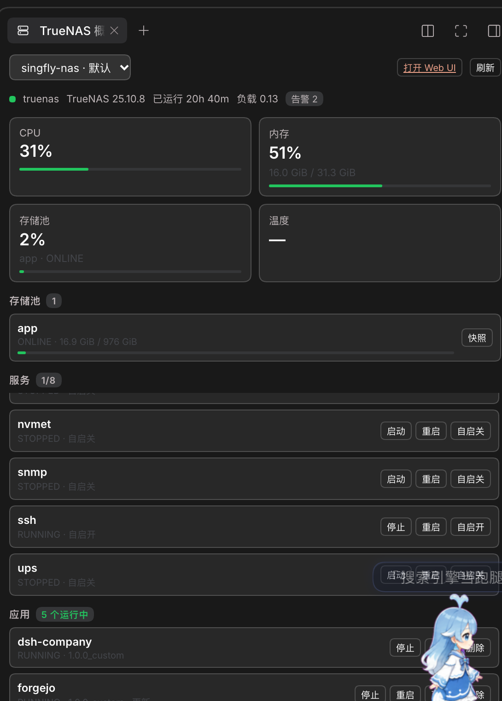

# TrueNAS manager for DSH

A DeepSeek Harness plugin that manages one or more TrueNAS systems over the
versioned JSON-RPC 2.0 WebSocket API (`/api/current`). Point it at a NAS with a
URL and an API key and it becomes part of the agent's toolkit; no REST, no extra
services, no runtime dependencies.

TrueNAS deprecated the REST API in 25.04 and removed it in 27, so this plugin
speaks the WebSocket API directly: `auth.login_ex` with the `API_KEY_PLAIN`
mechanism on current releases, and a fallback to `auth.login_with_api_key` on
older ones.

## Install

```bash
git clone https://github.com/Taoidle/dsh-truenas.git
cd dsh-truenas
npm install                                   # one runtime dependency
```

Then, from a DSH session:

```
plugin_manager action=install_bundle target=/absolute/path/to/dsh-truenas
```

Reload the DSH Web UI. The plugin appears in the sidebar's **Plugins** panel as
**TrueNAS manager**; its configuration page opens from the row's **Configure**
control inside the package page (**Included parts**).

## Configure

Open **Settings → TrueNAS** (the same page is also reachable from the plugin row:
Plugins → TrueNAS manager → Included parts → the row's configure control). It adds
one card per TrueNAS system with its address, user, API key and TLS option. The key
is verified against the NAS *before* it is stored in the DSH credential store, so a
typo never leaves a half-configured instance behind.


The page manages the same list as the `truenas_instances` tool, so either surface
works:

```
truenas_instances action="add" name="lab-nas" url="https://nas.lab.local" apiKey="1-xxxxxxxx" insecureTls=true
```

Several NAS boxes can be managed at the same time. The first entry is the default
when a tool call omits `instance`; **Make default** moves a system to the front.
Removing a system takes a second click and deletes its stored key.

The configuration itself is an instance list:

```json
{
  "instances": [
    { "name": "lab-nas", "url": "https://nas.lab.local", "username": "root", "insecureTls": true },
    { "name": "backup-nas", "url": "https://10.0.0.9", "username": "admin" }
  ],
  "timeoutMs": 60000,
  "jobTimeoutMs": 600000
}
```

API keys are **not** stored in that configuration. Each instance has a credential
name derived from its name (`lab-nas` → `TRUENAS_APIKEY_LAB_NAS`) and the key
lives in the DSH credential store.

### Self-signed certificates

`insecureTls` (the page's *Skip TLS certificate verification*) disables
certificate verification for that instance only. Prefer installing the NAS
certificate as trusted, or use a CA-signed certificate; the plugin asks Node to
skip verification, so treat the flag as a deliberate trade-off.

The connection still has to be TLS. TrueNAS **revokes an API key the moment it
is presented over an unencrypted connection** (`middlewared`'s
`login_ex_impl.py`: on `PAM_SUCCESS` with `not app.origin.secure_transport` it
calls `api_key.revoke(..., 'Attempt to use over an insecure transport')` and
answers `EXPIRED`). The plugin therefore refuses `http://` / `ws://` addresses
before the key is sent. Enable HTTPS on the NAS itself (System Settings →
General → GUI → HTTPS) or let a TLS proxy terminate *and* have middleware see a
secure origin — a proxy that terminates TLS and forwards plain HTTP to
middleware counts as insecure and will burn the key.

## Right-sidebar panel



With the [Better Sidebar](https://www.npmjs.com/package/dsh-better-sidebar) plugin
installed, this bundle adds a **TrueNAS overview** tab to the right sidebar. It
shows one system at a time (a dropdown switches when several are configured):

- cards for CPU, memory, the busiest pool and CPU temperature, with a load bar;
- every pool with health, usage and a one-click `Snapshot` (names look like
  `panel-20261111-112833`, so they are easy to find later);
- system services with `Start` / `Stop` / `Restart` and a boot-flag toggle
  (SMB, NFS, SSH, rsync, …);
- installed applications with `Start` / `Stop` / `Restart` / `Update`, and
  `Delete` behind a second click;
- disks with model, bus and live temperature, plus a `Self-test` button;
- certificate expiry with an `Expired` / `Renew soon` badge;
- running jobs with a progress bar and an `Abort` button;
- open alerts with `Dismiss`.

Slow sections are cached on their own cadence (services 10 s, disks 20 s,
certificates 60 s) so a 2.5-second stream does not re-query them on every tick;
a failed refresh keeps the last good rows. Certificate **renewal** has no API in
TrueNAS 25.10 (`certificate.*` has create/update/delete/query only, and `acme`
is just the DNS authenticators), so the card shows the countdown and points at
the NAS web UI instead of offering a button that cannot work.

The panel never talks to a NAS from the browser. It uses three same-origin
routes — `GET /dsh-truenas/panel?instance=<name>`,
`GET /dsh-truenas/panel/stream?instance=<name>` (server-sent events) and
`POST /dsh-truenas/panel/action` — which reuse the plugin's pooled WebSocket
client. The stream pushes a fresh snapshot every 2.5 seconds so job progress
moves without a browser poll; when `EventSource` is missing or the stream drops,
the panel falls back to polling `GET /dsh-truenas/panel` every six seconds. Both
paths only run while the tab is visible (`visible` from Better Sidebar's
`TabComponentProps`), so a hidden panel costs nothing. `app.delete` is refused unless the request
carries `confirm: true`; the UI arms the button for five seconds instead of
using a native dialog.

Metrics come from `reporting.get_data` over a 20-second window, because TrueNAS
only accepts `HOUR`/`DAY`/`WEEK`/`MONTH`/`YEAR` units and an hourly page is over
a megabyte. CPU is the sum of the per-core shares in the newest row, memory is
`physmem − available`, and the temperature card shows `—` on hardware that
exposes no CPU sensor (both test systems do). A dropped poll (a busy browser can
return `Failed to fetch`) is retried once; if the retry also fails the last
snapshot stays on screen and the status line shows `Refresh failed`.

Everything else (pools, snapshots, shares, tasks, replication, cloud, alerts,
Docker, privileges) stays available to the agent through the tools below.

## Tools

| Tool | Purpose |
| --- | --- |
| `truenas_instances` | List / add / update / remove / test configured instances. |
| `truenas_system` | Version and hardware, alerts, services, boot environments (list/activate), update status and available versions, system dataset, SSH settings, proactive support, tunables. |
| `truenas_storage` | Pools, datasets, create/delete datasets, scrub. |
| `truenas_snapshots` | List, create, delete, roll back, clone ZFS snapshots. |
| `truenas_shares` | SMB and NFS shares: list, create, enable/disable, delete. |
| `truenas_apps` | Apps: list, inspect, config, start, stop, redeploy, upgrade, roll back, pull images, edit a custom app, list images (and outdated images); install a custom app from Compose; delete it; manage Docker registries. |
| `truenas_jobs` | Recent jobs, one job, wait for a job, abort. |
| `truenas_network` | Interfaces and link state, static routes, and hostname/domain/gateway/DNS/proxy. |
| `truenas_users` | Users and groups (create, update, delete), filesystem ACLs, local privileges and roles, and API keys. |
| `truenas_replication` | Replication tasks: list, inspect, create from a raw payload, run, delete. |
| `truenas_cloud` | Cloud sync (rclone) and cloud backup (restic) tasks: list, run, one-off transfer, restore, abort, delete. |
| `truenas_alerts` | Current alerts (dismiss/restore), alert services (email, Slack, PagerDuty, SNMP, webhook, …), and outgoing mail. |
| `truenas_tasks` | Cron jobs and rsync tasks: list, inspect, create, update, delete, run now. |
| `truenas_reporting` | Netdata graph list, time-series data (CPU, memory, disk, interface, load, …), reporting config, exporters. |
| `truenas_docker` | Docker engine status and configuration, networks, NVIDIA runtime, and Apps dataset backups. |
| `truenas_services` | System services: list, start, stop, restart, reload, and enable/disable at boot. |
| `truenas_certificates` | Certificates with expiry state, ACME servers and DNS authenticators; delete. Renewal itself is a web-UI action (see Notes). |
| `truenas_disks` | Disks with model, bus, size and temperature; start a SMART self-test; wipe a disk behind `confirm`. |
| `truenas_call` | Any JSON-RPC method, for everything the curated tools miss. |

Every tool except `truenas_instances` and `truenas_call` takes an optional
`instance` name. Destructive actions (`delete_dataset`, snapshot delete and
rollback, share delete, job abort, app delete, registry remove, instance remove,
route remove, replication/cloud sync delete, alert service delete, user/group
delete, ACL replacement, certificate delete, SMART test, disk wipe) refuse to run
unless `confirm: true` is passed.

`truenas_call` is the escape hatch, but it is not a blind one: it keeps a table
of methods that take the system down or destroy data (`system.reboot`,
`system.shutdown`, `pool.export`, `pool.dataset.delete`, `disk.wipe`,
`update.update`, `failover.*`, …) and refuses to invoke them without
`confirm: true`, including when they are wrapped in `core.bulk`. That table is
in `lib/danger.js`; add a method there when a new API surface appears.

Examples:

```
truenas_system action="info"
truenas_storage action="pools" instance="backup-nas"
truenas_snapshots action="rollback" snapshot="tank/media@before-upgrade" confirm=true
truenas_apps action="restart" app="plex"

# Add a Docker registry the NAS pulls images from (ask the user for the token first)
truenas_apps action="registry_add" registryName="ghcr" \
  registryUri="https://ghcr.io" registryUsername="octocat" registryPassword="ghp_..."

# Install a custom app from a Compose document
truenas_apps action="create_custom" app="my-web" compose="services:
  web:
    image: ghcr.io/octocat/my-web:latest
    ports:
      - \"8080:80\"
    restart: unless-stopped"

# Deleting an app or a registry needs an explicit second call
truenas_apps action="delete" app="my-web" confirm=true

# Networking, accounts and scheduled transfers
truenas_network action="interfaces"
truenas_network action="dns_update" nameservers=["1.1.1.1","8.8.8.8"]
truenas_users action="list"
truenas_users action="acl" path="/mnt/app/forgejo"
truenas_replication action="list"
truenas_cloud action="list"
truenas_alerts action="services"

# Scheduled work
truenas_tasks action="cron_list"
truenas_tasks action="cron_add" description="nightly scrub report" command="/usr/bin/zpool status > /tmp/zpool.txt" \
  user="root" schedule={"minute":"30","hour":"3"}

# Metrics
truenas_reporting action="graphs"
truenas_reporting action="data" graph="cpu" unit="DAY"
truenas_reporting action="data" graph="interface" identifier="enp6s18" unit="HOUR"

# Docker engine, images and app maintenance
truenas_docker action="status"
truenas_docker action="networks"
truenas_apps action="images"
truenas_apps action="upgrade" app="plex" appVersion="latest"

# Host maintenance and access
truenas_system action="boot_envs"
truenas_system action="update_status"
truenas_system action="ssh_config"
truenas_users action="privileges"
truenas_users action="api_keys"

# Services, certificates and disks
truenas_services action="list"
truenas_services action="restart" name="smb"
truenas_services action="disable" name="ftp"
truenas_certificates action="list"
truenas_certificates action="authenticators"
truenas_disks action="list"
truenas_disks action="smart_test" name="sda" testType="SHORT"

# The escape hatch refuses system.reboot without confirmation too
truenas_call method="user.query" params=[[]]
```

Long-running methods return a job id. The curated tools wait for the jobs they
start; `truenas_call` does too when `waitJob: true` is passed.

## Dependencies

The plugin talks to TrueNAS with Node's built-in `net`/`tls`/`crypto` modules
only. Its single package dependency is `@deepseek-ai/schemastery`, used for the
configuration schema; harness packages (`dsh-tools`, `dsh-credentials`) are
deliberately not imported, so the plugin does not break when the harness build
changes. Because the bundle is linked into the profile, install that dependency
once in the checkout:

```bash
cd /path/to/dsh-truenas
npm install
```

## How it works

- `lib/ws.js` — a small RFC 6455 client over `node:net`/`node:tls`. It exists
  because `insecureTls` needs `rejectUnauthorized: false`, which the global
  `WebSocket` cannot do.
- `lib/truenas.js` — JSON-RPC framing, `auth.login_ex` (plain API key over TLS)
  with a legacy fallback, request serialization (the API rejects bursts with
  "too many concurrent calls"), one reconnect-and-retry on a dropped session,
  and job polling through `core.get_jobs`.
- `lib/instances.js` — instance normalization and lookups.
- `lib/admin.js` — verify-then-save operations shared by the tools and the
  settings page.
- `lib/http.js`, `lib/routes.js` — the settings page's same-origin routes on the
  DSH web server, with an origin/host guard so only the DSH page can call them.
- `lib/tool-kit.js` — the shared tool plumbing (schema, `ok`/`fail`,
  `requireConfirm`, the per-instance client resolution).
- `lib/danger.js` — the destructive-method table that `truenas_call` consults.
- `lib/tools.js` — the core tools, with compact text rendering and curated field
  projections; the network, users/ACL, replication, cloud and alert tools live
  next to it in `lib/tools-*.js`.
- `client.js` — the React settings page, rendered into the plugin row's
  `plugins.row.config` seat. It is a plain module loaded by the harness, so it
  needs no bundler and no duplicate React.
- `index.js` — configuration schema, one client per instance, the settings
  routes, and persistence of the instance list through the harness config
  editor. `instances` is a volatile field, so adding or removing an instance
  takes effect immediately without a plugin restart.

`truenas_call` is the escape hatch: all method names and parameters are
documented at <https://api.truenas.com/>.

## Tests

```bash
node --test test/*.test.mjs
```

The suite runs against an in-process mock of the WebSocket API (handshake,
masked client frames, JSON-RPC dispatch, jobs), so it needs no NAS.

## Notes

- Authentication uses the plain API key over TLS (`API_KEY_PLAIN`). TrueNAS 26
  prefers SCRAM-SHA-512; it is not implemented here, so an API key must be
  accepted through the plain mechanism (it is an explicit, supported mechanism).
- Only the WebSocket API is supported: `/websocket` (the pre-25.04 protocol) and
  the removed REST endpoints are not.
- WebSocket connections are kept per instance and closed when the plugin
  unloads.
- A bare `host:port` is tried over TLS first. If that port turns out to speak
  plain HTTP (a reverse proxy on `:80`/`:86` — OpenSSL reports
  `WRONG_VERSION_NUMBER`), the plugin explains it and refuses to authenticate:
  plaintext API-key login makes TrueNAS revoke the key on first use. Enable
  HTTPS on the NAS or front it with a TLS listener that middleware treats as
  secure, then point the plugin at that port. Verification never stores an
  instance it could not authenticate.
- A key that is already dead answers `Authentication failed: the API key ... is
  expired or was revoked`; create a new one once the instance uses TLS.

## License

MIT — see [LICENSE](LICENSE).
