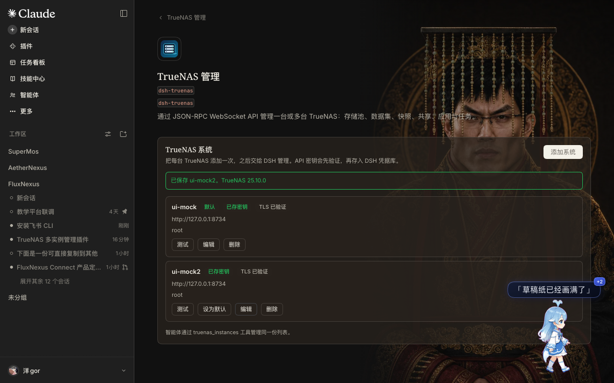

# TrueNAS manager for DSH

A DeepSeek Harness plugin that manages one or more TrueNAS systems over the
versioned JSON-RPC 2.0 WebSocket API (`/api/current`). Point it at a NAS with a
URL and an API key and it becomes part of the agent's toolkit; no REST, no extra
services, no runtime dependencies.

TrueNAS deprecated the REST API in 25.04 and removed it in 27, so this plugin
speaks the WebSocket API directly: `auth.login_ex` with the `API_KEY_PLAIN`
mechanism on current releases, and a fallback to `auth.login_with_api_key` on
older ones.

## Install

```bash
git clone https://github.com/Taoidle/dsh-truenas.git
cd dsh-truenas
npm install                                   # one runtime dependency
```

Then, from a DSH session:

```
plugin_manager action=install_bundle target=/absolute/path/to/dsh-truenas
```

Reload the DSH Web UI. The plugin appears in the sidebar's **Plugins** panel as
**TrueNAS manager**; its configuration page opens from the row's **Configure**
control inside the package page (**Included parts**).

## Configure

Open the row's configuration page. It adds one card per TrueNAS system with its
address, user, API key and TLS option. The key is verified against the NAS
*before* it is stored in the DSH credential store, so a typo never leaves a
half-configured instance behind.



The page manages the same list as the `truenas_instances` tool, so either surface
works:

```
truenas_instances action="add" name="lab-nas" url="https://nas.lab.local" apiKey="1-xxxxxxxx" insecureTls=true
```

Several NAS boxes can be managed at the same time. The first entry is the default
when a tool call omits `instance`; **Make default** moves a system to the front.
Removing a system takes a second click and deletes its stored key.

The configuration itself is an instance list:

```json
{
  "instances": [
    { "name": "lab-nas", "url": "https://nas.lab.local", "username": "root", "insecureTls": true },
    { "name": "backup-nas", "url": "https://10.0.0.9", "username": "admin" }
  ],
  "timeoutMs": 60000,
  "jobTimeoutMs": 600000
}
```

API keys are **not** stored in that configuration. Each instance has a credential
name derived from its name (`lab-nas` → `TRUENAS_APIKEY_LAB_NAS`) and the key
lives in the DSH credential store.

### Self-signed certificates

`insecureTls` (the page's *Skip TLS certificate verification*) disables
certificate verification for that instance only. Prefer installing the NAS
certificate as trusted, or use a CA-signed certificate; the plugin asks Node to
skip verification, so treat the flag as a deliberate trade-off.

## Tools

| Tool | Purpose |
| --- | --- |
| `truenas_instances` | List / add / update / remove / test configured instances. |
| `truenas_system` | Version and hardware, alerts, services. |
| `truenas_storage` | Pools, datasets, create/delete datasets, scrub. |
| `truenas_snapshots` | List, create, delete, roll back, clone ZFS snapshots. |
| `truenas_shares` | SMB and NFS shares: list, create, enable/disable, delete. |
| `truenas_apps` | Installed apps: list, inspect, config, start, stop, redeploy. |
| `truenas_jobs` | Recent jobs, one job, wait for a job, abort. |
| `truenas_call` | Any JSON-RPC method, for everything the curated tools miss. |

Every tool except `truenas_instances` and `truenas_call` takes an optional
`instance` name. Destructive actions (`delete_dataset`, snapshot delete and
rollback, share delete, job abort, instance remove) refuse to run unless
`confirm: true` is passed.

Examples:

```
truenas_system action="info"
truenas_storage action="pools" instance="backup-nas"
truenas_snapshots action="rollback" snapshot="tank/media@before-upgrade" confirm=true
truenas_apps action="restart" app="plex"
truenas_call method="user.query" params=[[]]
```

Long-running methods return a job id. The curated tools wait for the jobs they
start; `truenas_call` does too when `waitJob: true` is passed.

## Dependencies

The plugin talks to TrueNAS with Node's built-in `net`/`tls`/`crypto` modules
only. Its single package dependency is `@deepseek-ai/schemastery`, used for the
configuration schema; harness packages (`dsh-tools`, `dsh-credentials`) are
deliberately not imported, so the plugin does not break when the harness build
changes. Because the bundle is linked into the profile, install that dependency
once in the checkout:

```bash
cd /path/to/dsh-truenas
npm install
```

## How it works

- `lib/ws.js` — a small RFC 6455 client over `node:net`/`node:tls`. It exists
  because `insecureTls` needs `rejectUnauthorized: false`, which the global
  `WebSocket` cannot do.
- `lib/truenas.js` — JSON-RPC framing, `auth.login_ex` (plain API key over TLS)
  with a legacy fallback, request serialization (the API rejects bursts with
  "too many concurrent calls"), one reconnect-and-retry on a dropped session,
  and job polling through `core.get_jobs`.
- `lib/instances.js` — instance normalization and lookups.
- `lib/admin.js` — verify-then-save operations shared by the tools and the
  settings page.
- `lib/http.js`, `lib/routes.js` — the settings page's same-origin routes on the
  DSH web server, with an origin/host guard so only the DSH page can call them.
- `lib/tools.js` — the eight tools, with compact text rendering and curated field
  projections.
- `client.js` — the React settings page, rendered into the plugin row's
  `plugins.row.config` seat. It is a plain module loaded by the harness, so it
  needs no bundler and no duplicate React.
- `index.js` — configuration schema, one client per instance, the settings
  routes, and persistence of the instance list through the harness config
  editor. `instances` is a volatile field, so adding or removing an instance
  takes effect immediately without a plugin restart.

`truenas_call` is the escape hatch: all method names and parameters are
documented at <https://api.truenas.com/>.

## Tests

```bash
node --test test/*.test.mjs
```

The suite runs against an in-process mock of the WebSocket API (handshake,
masked client frames, JSON-RPC dispatch, jobs), so it needs no NAS.

## Notes

- Authentication uses the plain API key over TLS (`API_KEY_PLAIN`). TrueNAS 26
  prefers SCRAM-SHA-512; it is not implemented here, so an API key must be
  accepted through the plain mechanism (it is an explicit, supported mechanism).
- Only the WebSocket API is supported: `/websocket` (the pre-25.04 protocol) and
  the removed REST endpoints are not.
- WebSocket connections are kept per instance and closed when the plugin
  unloads.

## License

MIT — see [LICENSE](LICENSE).
